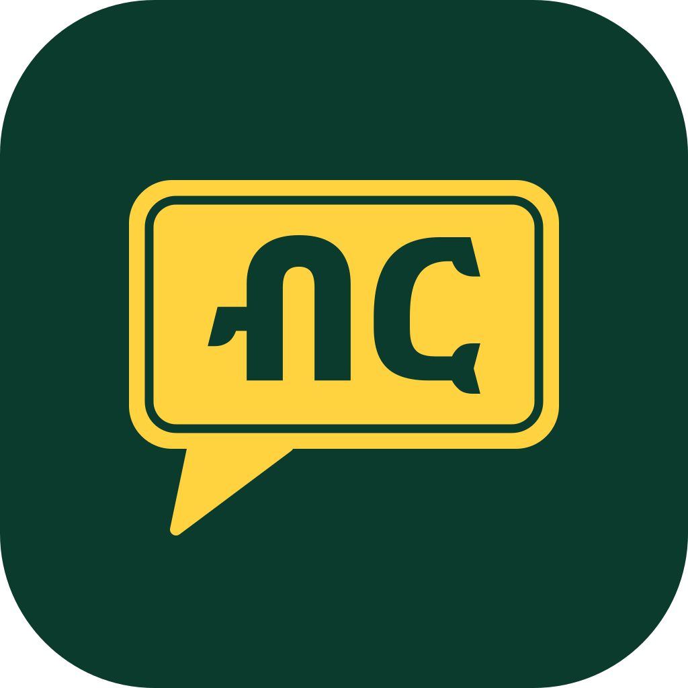

<p align="center"></p>

# Birr: count your own money, in your own language

Birr is a voice-first Android app that lets blind and low-vision people in Ethiopia count their own cash. Hold the phone over your notes and ask "How much is this?" or "I paid 500 for 320. Is my change right?", in English or Amharic. Birr reads every note with Meta's Muse Spark Open, adds the total in code, and says the answer out loud. When it is not sure, it asks you to scan again instead of guessing.

Built during the Meta Global AI Developer Hackathon (Oct 26 to Nov 4, 2026).

## Try it

| | |
|---|---|
| **Web demo, no install** | https://birr-demo.vercel.app — pick a sample pile or upload a photo, in English or Amharic |
| **Android app** | Download `birr.apk` from the [v1.0-hackathon release](https://github.com/Sgfhnn/Meta-hackaton/releases/tag/v1.0-hackathon) and sideload it (built by `.github/workflows/android-apk.yml`) |
| **Demo video** | https://youtu.be/3ZomCMt0GbA (3 minutes, filmed with the real app) |

## Why it matters

Ethiopian birr notes (5, 10, 50, 100, 200) are hard to tell apart by touch, so a blind person has to trust someone else to count their money at every payment. Most money-reader apps don't know Ethiopian notes, and none answer in Amharic. Birr does both, and its rule is simple: **never speak a wrong total**. A blind user can't check the number, so a rescan is always better than a guess.

## What the app does

- **Talk to it.** A hands-free voice assistant: ask to count, check your change, or ask what it can do. It understands English and Amharic and answers in the language you chose.
- **Live guidance.** While you hold the phone, Birr tells you when the notes are in view ("Hold still, I'm counting").
- **Count.** It names every note and the total: "You have 360 birr. One 200, one 100, one 50 and one 10."
- **Check change.** "You paid 500 for 320. Your change should be 180 birr... You got 180 birr. Your change is correct."
- **Blind-friendly first launch.** A spoken language choice, and spoken permission prompts that open by themselves. Works with the screen off and with TalkBack.
- **Amharic voice.** Every Amharic answer is spoken by Meta MMS-TTS, with numbers turned into words in code.

## Results

On 20 test piles photographed during the hackathon, the live reader got **18 exact, 0 wrong, and asked for a rescan on 2**. Zero wrong totals is the bar every change had to pass.

## How it works

```
 phone mic ──► Meta Omnilingual ASR ──► Muse Spark Open: what did they ask?
                                                │
 phone camera ──► Muse Spark Open, read A ──┐   │
             └──► Muse Spark Open, read B ──┴─► both reads agree? ── no ──► "Please scan again"
                   (with reference sheets)            │ yes
                                                      ▼
                                    total and change computed in code
                                                      ▼
                         answer written from fixed templates (English / Amharic)
                                                      ▼
                                   Meta MMS-TTS speaks it in Amharic
```

1. **Ask.** Meta Omnilingual ASR (`omniASR_CTC_300M_v2`) transcribes the question on our own server. Muse Spark Open turns the transcript into an intent (count, or check change with the amounts), and code checks the amounts.
2. **Photo.** The app caps the photo at 2048 px and strips EXIF, including GPS.
3. **Two reads.** Two Muse Spark Open (`muse-spark-open-1026`, on Baseten) reads run in parallel, one plain and one with reference sheets of every note. A total is spoken only when both list the same notes and none is unclear.
4. **Answer.** Code computes the total and the change, then fills fixed English or Amharic templates. No model writes a number.
5. **Speak.** Meta MMS-TTS (`facebook/mms-tts-amh`) speaks Amharic on the CPU. English uses the phone's voice.

All of the AI in the product is Meta's: Muse Spark Open reads the notes and understands the question, Omnilingual ASR hears it, and MMS-TTS speaks Amharic.

## Repo layout

| Path | What it is |
|---|---|
| `app/` | Expo (React Native) Android app. See `app/README.md` |
| `birr/` | FastAPI backend: `/assist` (voice assistant), `/frame` (live guidance), `/scan` (count), `/intent`, `/speak`, `/phrases`, `/health`. Contract in `docs/api.md` |
| `asr_service/` | Meta Omnilingual ASR as a small local service |
| `web/` | The web demo, deployed to Vercel as a Python function. See `web/README.md` |
| `.github/workflows/` | CI tests, the APK build, and an Android emulator end-to-end test every APK must pass |
| `tests/`, `tools/e2e/` | Backend tests (all models mocked) and end-to-end app checks |

## Run the backend

```bash
cp .env.example .env        # fill in keys locally; .env is never committed
uv sync --extra tts         # includes CPU PyTorch for Meta MMS-TTS (about 1 GB)
set -a; . ./.env; set +a
uv run --extra tts uvicorn birr.api:app --port 8000   # one worker: scan jobs live in the process
```

Set `ASR_URL` to the `asr_service/` instance for spoken questions. Reference sheets for read B load from `REFS_DIR`; they are kept out of this repo because they were made from pre-event photos, and without them no scan speaks a total (`/health` shows `refs`).

Tests: `uv run pytest` (260 tests, every model mocked, no keys or network needed).

## Build the app

Run the **Android APK** workflow in GitHub Actions (optionally with your backend URL as `api_url`), or see `app/README.md` to run it with Expo Go.

## What we tried

- **A count cross-check with SAM 3.** Segmenting notes to count them blocked correct totals more often than it caught wrong ones, so it is switched off (`SAM_OFF=1`). The code stays for future work.
- **Our own note detector.** A YOLOv8s and DETR detector with a DINOv2 reader, trained on free Kaggle GPUs, got 3 of 29 real piles exact. Not used.
- **Fine-tuning Muse Glimmer 30B** with LoRA on Kaggle. The best version still gave 1 wrong total in 24, which fails the zero-wrong rule, so Muse Spark Open stays the only reader.

## Disclosures

- **Models.** Meta Muse Spark Open on Baseten; Meta Omnilingual ASR (Apache 2.0) and Meta MMS-TTS (CC-BY-NC 4.0) on our own server. The code keeps an optional Gemini fallback for spoken questions, which is off in the live app. The demo video's English narration and subtitles were made with Google Gemini; the app's voices in the video are the app's own.
- **Data.** The backend stores no photos and no recordings, only traces with labels and timings. Questions are transcribed on our server, and neither audio nor transcript is kept.
- **Pre-event material.** Photos taken before the event were used only for development. They, and the reference sheets made from them, are not in this repo.
- **Amharic.** Answers are fixed templates, drafted with AI help and reviewed by a native Amharic speaker on the team; code fills in every number. This project uses the universal romanizer 'uroman' by Ulf Hermjakob, USC Information Sciences Institute (2015-2020).
- **Limits.** Ethiopian birr notes of 5, 10, 50, 100 and 200 (2020 series) only. It does not detect counterfeits.
- **Secrets.** Keys live in environment variables only (`.env.example` lists them).
- **AI assistance.** Parts of this code were written with AI coding assistants.
- **Licenses.** See `LICENSE` and `docs/licenses.md`.
